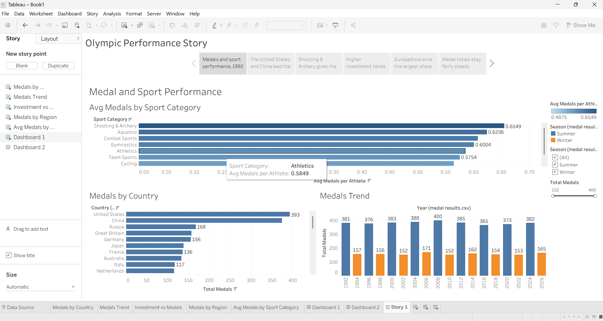
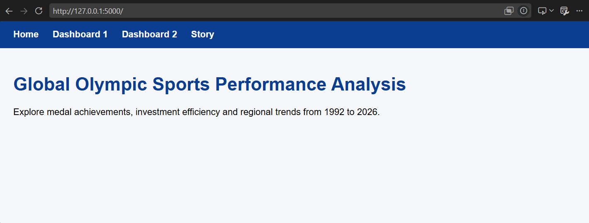
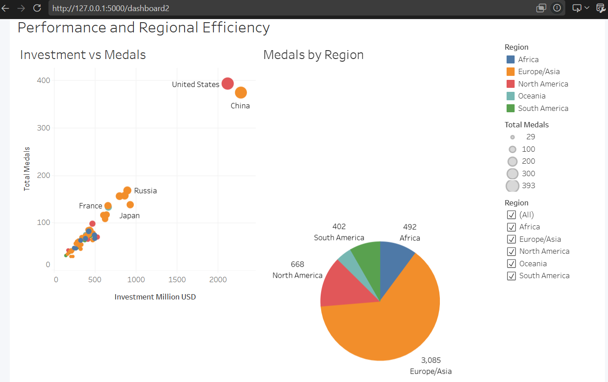
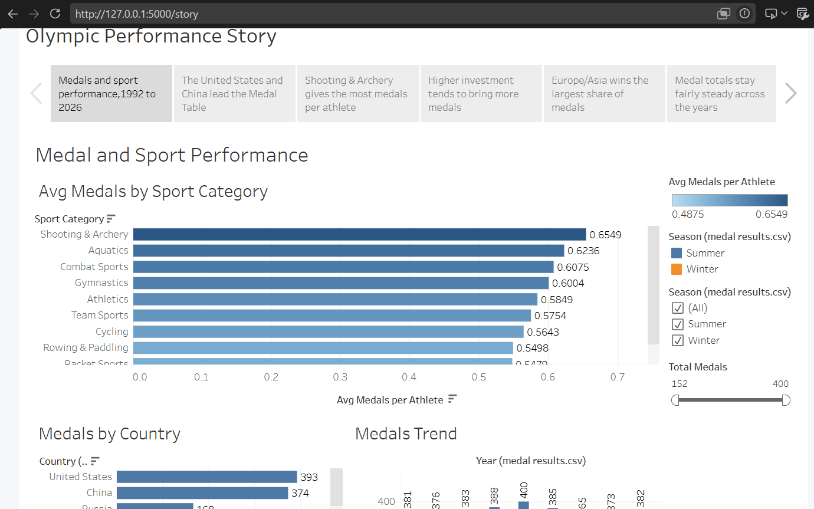

# Olympic Performance Analysis (1992–2026)

An interactive analytics project that explores what drives Olympic success. Data is analysed and visualised in **Tableau**, then embedded in a **Flask** web app so the dashboards and story can be viewed on a single website.

**Live Tableau Public:** https://public.tableau.com/app/profile/mohammed.sukhawala/viz/OlympicPerformanceAnalysis_17931144556200/Story1?publish=yes

**Demo video:** [ADD LINK HERE]

**Author:** Mohammed Sukhawala

---

## Overview

The Olympic Games are a global stage where nations compete to show sporting excellence, but the volume of historical data makes it hard to see what really contributes to success. This project analyses Olympic data from 1992 to 2026 to answer questions such as:

- Which sports and countries win the most medals?
- How efficient is each country at turning athletes and investment into medals?
- How does performance differ by region?
- Do host countries gain an advantage, and how do medal totals change over time?

## Features

- **7 visualisations:** bar, horizontal bar, bubble, pie, donut and line charts
- **2 interactive dashboards** with filters (Year, Season, Region, Country) and click-to-filter actions
- **Tableau story** with 5–6 scenes that walk through the findings
- **Calculated fields** such as Avg Medals per Athlete, Medal Efficiency %, Total Medals and Host Flag
- **Flask web app** that embeds the dashboards and story

## Tech Stack

| Tool | Purpose |
|------|---------|
| Tableau Public | Data connection, charts, dashboards, story |
| Python 3 + Flask | Web app that embeds Tableau |
| HTML / CSS | Page templates and styling |
| Git + GitHub | Version control and hosting the code |

## Project Structure

```
Olympic-performance-analysis-/
├── app.py                 # Flask app
├── requirements.txt       # Python dependencies
├── templates/             # HTML pages (base, index, dashboards, story)
├── static/                # CSS and images
├── data/                  # athletes.csv, medal_results.csv
├── tableau/               # Tableau workbook (.twbx)
├── docs/                  # Project documentation and screenshots
├── .gitignore
└── README.md
```

## Dataset

Two tables are used:

- **athletes**: athlete details (country, sport, year, season)
- **medal_results**: gold, silver and bronze counts per country, sport and year

## How to Run Locally

1. Clone the repository
   ```bash
   git clone https://github.com/mohammedsw-jpg/Olympic-performance-analysis-.git
   cd Olympic-performance-analysis-
   ```
2. (Optional) Create a virtual environment
   ```bash
   python -m venv venv
   venv\Scripts\activate
   ```
3. Install dependencies
   ```bash
   pip install -r requirements.txt
   ```
4. Add your published Tableau Public URLs to the `VIZ` dictionary in `app.py`
5. Start the app
   ```bash
   python app.py
   ```
6. Open http://127.0.0.1:5000 in your browser

## Visualisations

| # | Sheet | Chart type |
|---|-------|-----------|
| 1 | Avg Medals per Athlete by Sport Category | Horizontal bar |
| 2 | Global Performance Metrics by Country | Bar |
| 3 | Global Sports Investment vs. Medal Performance | Bubble |
| 4 | Avg Medal Efficiency % by Region | Pie |
| 5 | Trend of Total Medals Awarded Over the Years | Line |
| 6 | Medal Totals Across Olympic Hosts | Bar |
| 7 | Regional Medal Efficiency and Distribution by Sport | Donut |

## Dashboards

- **Dashboard 1: Medal and Sport Performance** (sheets 1, 2, 5)
- **Dashboard 2: Performance and Regional Efficiency** (sheets 3, 4, 6, 7)

## Screenshots














## Performance Testing

| Metric | Result |
|--------|--------|
| Amount of data loaded | [rows / extract size] |
| Data filters used | Season, Year |
| Calculated fields | [count] |
| Visualisations | 5 sheets, 2 dashboards, 1 story |
## Documentation

Full step-by-step documentation: [`docs/Project_Documentation.pdf`](docs/Project_Documentation.pdf)

## Future Scope

- Add predictive models for medal forecasting
- Add more data sources (population, GDP)
- Deploy the Flask app online

## License

For educational use.